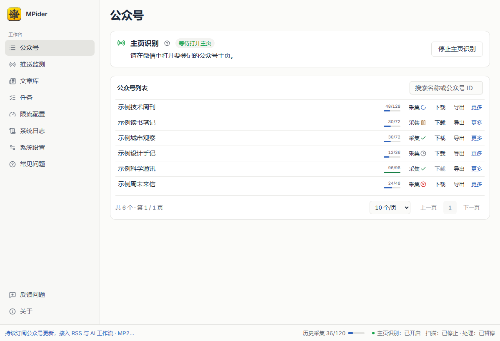
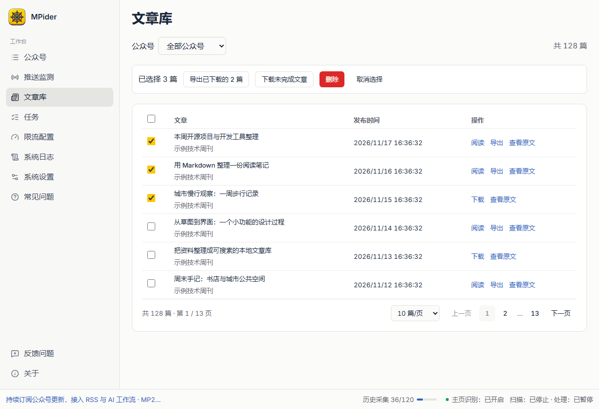
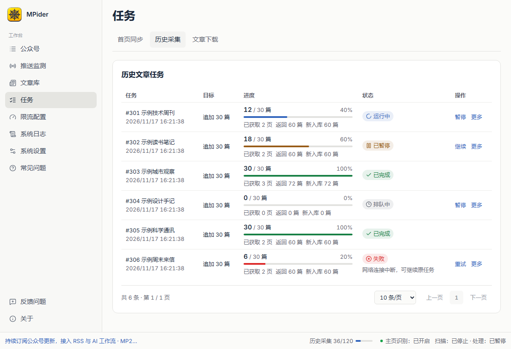

<div align="center">

<h1>MPider</h1>

<p>微信公众号文章采集与本地归档</p>
<p>按公众号管理文章，保存正文与图片，离线阅读，同时导出 Markdown 和 HTML。</p>

<p>
  <a href="https://github.com/ZyFanTJ/mpider/releases"></a>
  
  <a href="LICENSE"></a>
</p>

<p>
  <a href="https://github.com/ZyFanTJ/mpider/releases/latest">下载客户端</a> ·
  <a href="https://zyfantj.github.io/mpider/">项目官网</a> ·
  <a href="docs/windows-standalone.md">使用说明</a> ·
  <a href="docs/faq.md">常见问题</a> ·
  <a href="https://github.com/ZyFanTJ/mpider/issues/new/choose">反馈问题</a>
</p>
<p>
  <a href="https://xhslink.cn/o/8c23uHExcT6">演示视频</a> ·
  <a href="https://qm.qq.com/q/s4JavFxA3e">进群交流</a> ·
  <a href="CHANGELOG.md">更新记录</a>
</p>

</div>



<p align="center"><sub>公众号工作台 · 界面演示使用虚构公众号与文章</sub></p>

## 主要特性

### 按公众号采集，按任务管理

通过主页识别登记公众号，在同一行完成采集、下载和导出。首页同步获取最新文章，历史采集支持指定篇数或截止日期。任务保存检查点，暂停后可继续，更新会话后可沿原位置续采。

### 自由选择下载范围

支持单篇下载、勾选下载和按公众号填写下载篇数。默认保存封面与正文图片，也可选择只下载正文。已有正文和已入队文章自动去重，下载进度持续保存在本机。

### Markdown 与 HTML 同时导出

一次导出生成两种文章格式，并附可搜索的 `index.html`、共享图片目录和 CSV 清单。支持导出部分已下载文章，HTML 保留正文排版，Markdown 便于检索和后续整理。

### 推送发现与链接队列

后台发现本机微信中的公众号文章链接，保存到待处理队列。链接处理可独立开启，校验后去重入库。停止扫描后，已保存的链接仍可继续处理。

### 清晰的进度与请求记录

首页用紧凑行展示公众号，任务页显示数量、百分比和运行状态。底栏提供活动任务入口，系统日志支持筛选与导出。列表、正文和图片请求分别配置间隔与预算，并按各自的并发规则调度。

### 本地存储与离线阅读

文章和任务进度保存在本机，SQLite 管理文章索引，正文与图片归档到本地文件。已下载文章可在客户端阅读，也可通过导出目录在浏览器中离线浏览。软件窗口关闭后进入系统托盘，后台任务继续运行。

## 界面预览

以下截图使用虚构公众号与文章，展示当前前端的操作界面。

### 文章库

按公众号筛选文章，勾选后批量下载或导出，已保存正文可直接阅读。



### 任务进度

首页同步、历史采集和文章下载分别管理。任务进度展示目标完成情况，同时保留实际返回与入库数量。



## 下载与安装

运行环境为 **Windows 10/11 x64**。当前原生采集已验证的微信版本为 **4.1.15.56 x64**，首次登记公众号与更新会话时需要登录微信，并保持桌面可交互。

从 [GitHub Releases](https://github.com/ZyFanTJ/mpider/releases/latest) 获取对应版本，文件与验证范围以发行页面为准。

| 安装方式 | 使用说明 |
| --- | --- |
| Windows x64 安装包 | 双击 EXE，按中文向导安装，从开始菜单启动 MPider |
| 精简安装包 | 携带 Python / Frida，自动检测 WebView2，缺少时联网下载安装。向导提供微软手动下载链接 |
| 完整离线安装包 | 携带 WebView2 离线安装程序，适合提前准备运行环境 |
| 便携 ZIP | 完整解压后运行 `MPider.exe`，保留旁边的 `runtime/` |
| `SHA256SUMS` | 校验下载文件的 SHA-256 摘要 |

安装包附带 Python **3.12.10**、Frida **17.23.3** 和 cryptography **50.0.2** 及相关依赖，目标电脑可直接使用包内运行环境。签名更新配置与 Windows 代码签名状态以对应发行说明为准。

```powershell
Get-FileHash .\MPider_2.0.1_x64-setup.exe -Algorithm SHA256
```

安装、迁移和备份的完整步骤见 [Windows 独立运行说明](docs/windows-standalone.md)。

## 开始采集

1. **登记公众号**。在「公众号」页开启「主页识别」，到微信手动打开目标公众号主页，等待名称与会话登记。
2. **采集文章列表**。在公众号行点击「采集」，选择同步最新文章或采集历史文章，按需要设置篇数或截止日期。
3. **下载正文**。点击「下载」并填写篇数，或在文章库勾选指定文章。只保存正文时，取消勾选「下载封面和正文图片」。
4. **阅读与导出**。在文章库阅读已有正文，或选择导出篇数，生成 Markdown、HTML 和文章索引。
5. **继续任务**。在任务页暂停或继续操作。需要更新会话时，按提示在微信重新打开目标公众号主页。

采集目标与整页入库数量分别记录。例如目标为 30 篇、整页返回 72 篇时，可继续选择下载其中 30 篇，再导出已下载文章中的指定篇数。

重启应用后，未完成任务保留检查点并暂停，由用户选择继续。备份时保留「系统设置」显示的完整数据目录，正文归档与数据库一起迁移。受 Windows DPAPI 保护的会话材料绑定当前用户，换机器后需重新登记会话。

## 技术栈

<p>
  
  
  
  
  
  
  
</p>

| 组件 | 职责 |
| --- | --- |
| Tauri 2 · Rust | 桌面应用、任务调度、请求策略与本地归档 |
| React 18 · TypeScript | 工作台界面、交互与状态展示 |
| Tailwind CSS · Radix UI | 界面样式与交互组件 |
| Python · Frida | 本机微信原生调用观察与会话工作进程 |
| SQLite | 文章索引、任务状态与请求账本 |
| article-md · htmd | 正文解析与 Markdown 转换 |

实现流程见 [实现原理](docs/how-it-works.md)，原生会话与检查点见 [协议说明](docs/wechat-session-protocol.md)。

## 请求控制与适配范围

列表采集的初始间隔为 **90–120 秒**，滚动 24 小时预算为 **60 次**。正文与图片的初始间隔各为 **1 秒**，并发各为 **4**。可在「限流配置」中调整，具体规则见 [频率与预算说明](docs/request-policy.md)。

采集受微信版本、会话状态和服务端访问限制影响。使用个人微信会话存在账号受限或封禁风险，默认参数的安全性未经平台确认。Frida 附加可能引发微信退出，微信升级后需要重新验证适配。操作前可查看 [常见问题](docs/faq.md) 中的适配与使用说明。

## 数据与隐私

文章库与任务进度保存在本机，正文和图片按文章归档，日志也写入本地数据目录。会话密钥与协议证据使用当前 Windows 用户的 DPAPI 保护，普通文章导出使用本地归档内容。

采集访问微信服务与文章图片来源。底栏推荐位定期从 GitHub 读取公开配置，配置签名更新的构建会检查公开更新清单。相关请求的数据范围见 [广告说明](docs/advertisements.md) 与 [客户端更新说明](docs/app-updates.md)。反馈问题前，请检查并脱敏日志，保护会话文件和数据库。

文章版权归原作者及权利人所有，请在授权范围内获取和保存内容。安全问题可通过 [安全政策](SECURITY.md) 中的渠道反馈。

## 开发与贡献

开发环境使用 Node.js **24+**、**pnpm** 和 Rust。Rust 版本见 `rust-toolchain.toml`，Windows 构建需要 Visual Studio C++ Build Tools 与 Windows SDK。

```sh
pnpm install --frozen-lockfile
pnpm exec tsc --noEmit -p frontend/tsconfig.json
pnpm build
pnpm test
cargo fmt --all -- --check
cargo clippy --locked --workspace --all-targets -- -D warnings
cargo test --locked -p mpider-core -p article-md -p mpider-tauri
pnpm tauri dev
```

| 文档 | 内容 |
| --- | --- |
| [贡献指南](CONTRIBUTING.md) | 开发流程、检查规则与提交约定 |
| [Windows 构建说明](docs/windows-standalone.md) | 运行环境、打包与发行校验 |
| [文章导出](docs/article-export.md) | 格式、目录结构与图片处理 |
| [推送监测](docs/push-monitor.md) | 链接发现与队列处理 |
| [系统日志](docs/system-logs.md) | 日志筛选、诊断与导出 |
| [实验室](docs/laboratory.md) | 游标实验、结果解读与报告 |
| [更新记录](CHANGELOG.md) | 版本变更 |
| [第三方声明](THIRD-PARTY-NOTICES.md) | 依赖来源与许可 |

项目采用 [MIT 许可证](LICENSE)。

持续 RSS 订阅可了解 [MP2Rss](https://mp2rss.bugcode.dev/)，历史文章下载服务可了解 [MPHistory](https://mphistory.followto.us/)。两个链接分别指向独立服务。
